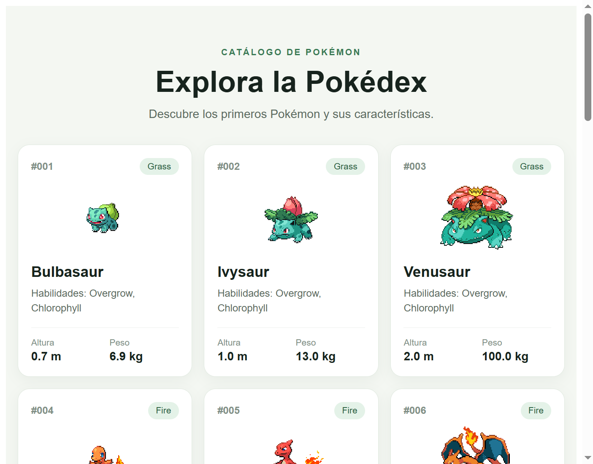
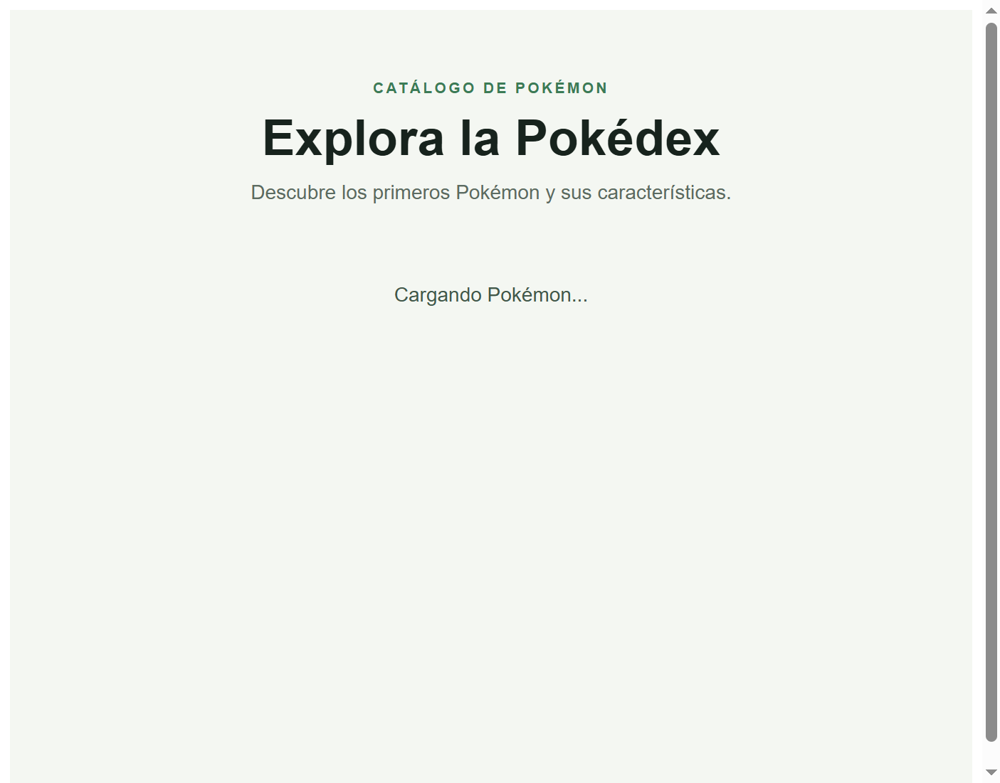
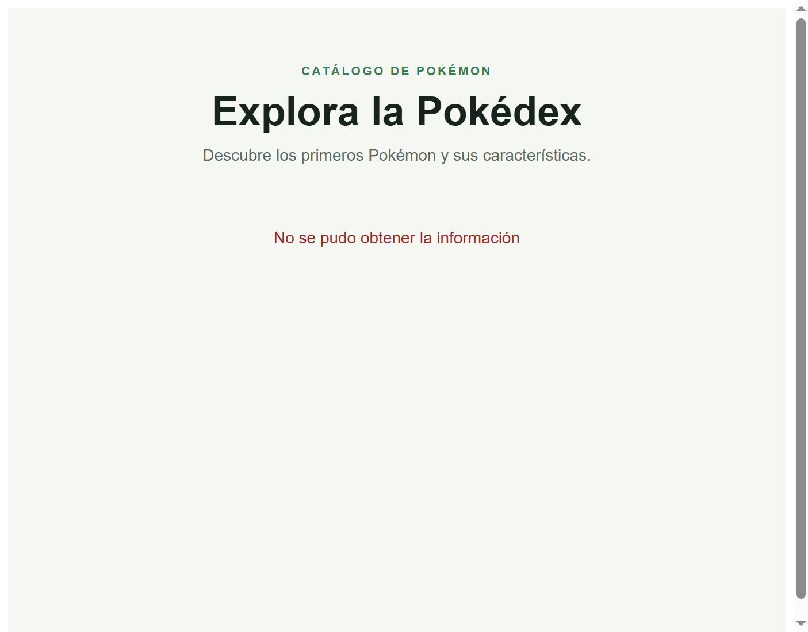

# Catálogo PokéAPI

Aplicación Angular que muestra los primeros 20 Pokémon con sus imágenes y características.

## API utilizada

Se eligió [PokéAPI](https://pokeapi.co/). Antes de programar se inspeccionó en el navegador la
respuesta JSON de [`/pokemon/pikachu`](https://pokeapi.co/api/v2/pokemon/pikachu). La respuesta
individual contiene datos como `id`, `name`, `height` y `weight`, además de listas y objetos
anidados como `types`, `abilities` y `sprites`.

El endpoint de colección devuelve `count`, `next`, `previous` y `results`. Cada elemento de
`results` incluye `name` y `url`.

## Endpoints utilizados

- `GET https://pokeapi.co/api/v2/pokemon?limit=20&offset=0`: obtiene la primera página de
  resultados.
- `GET https://pokeapi.co/api/v2/pokemon/{id-o-nombre}`: obtiene los detalles de un Pokémon,
  por ejemplo `https://pokeapi.co/api/v2/pokemon/pikachu`.

## Campos mostrados

- `id` y `name`: número y nombre.
- `sprites.front_default`: imagen frontal.
- `types[].type.name`: tipo principal.
- `abilities[].ability.name`: habilidades.
- `height` y `weight`: convertidos de decímetros a metros y de hectogramos a kilogramos.

La aplicación separa las consultas en `ApiService`, los estados y resultados en `Lista`, y la
presentación de cada Pokémon en `Tarjeta`.

## Cómo ejecutar el proyecto

Desde la carpeta del proyecto, instala las dependencias y arranca el servidor:

```bash
npm install
ng serve
```

Abre `http://localhost:4200/` en el navegador.

## Capturas de pantalla

### Lista de Pokémon



### Estado de carga



### Estado de error



## Compilación y pruebas

```bash
npm run build
npm test
```
